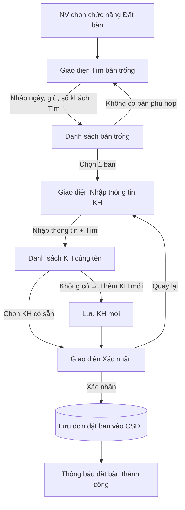
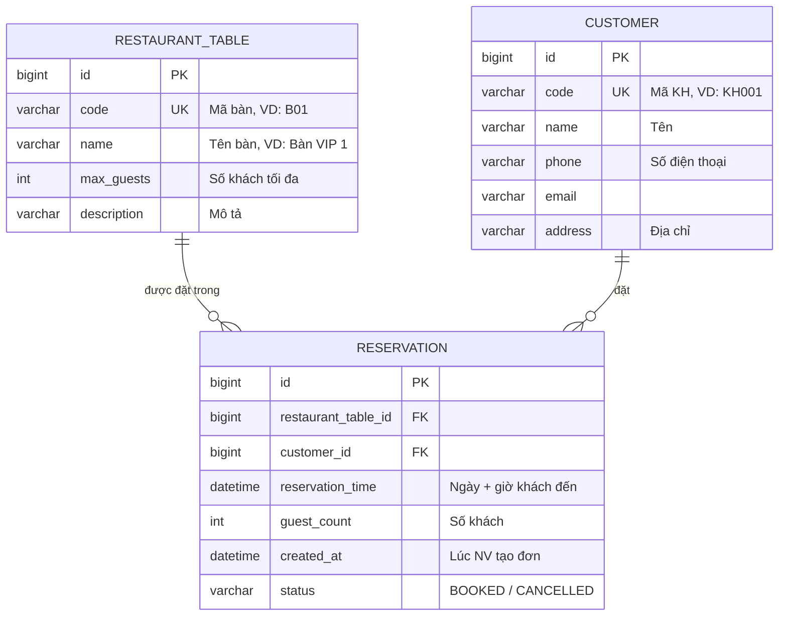

# reservation_restaurant

Ứng dụng web **đặt bàn nhà hàng** viết bằng Spring Boot. Đây là bài luyện tập trong khóa học Spring Boot: nhân viên nhà hàng dùng hệ thống để đặt bàn cho khách gọi điện đến.

---

## Mục lục

- [1. Bài toán](#1-bài-toán)
- [2. Luồng nghiệp vụ](#2-luồng-nghiệp-vụ)
- [3. Các màn hình](#3-các-màn-hình)
- [4. Cơ sở dữ liệu](#4-cơ-sở-dữ-liệu)
- [5. Quy tắc tìm bàn trống](#5-quy-tắc-tìm-bàn-trống)
- [6. Công nghệ sử dụng](#6-công-nghệ-sử-dụng)
- [7. Cấu trúc thư mục](#7-cấu-trúc-thư-mục)
- [8. Các đường dẫn (endpoint)](#8-các-đường-dẫn-endpoint)
- [9. Cài đặt và chạy](#9-cài-đặt-và-chạy)
- [10. Các trường hợp cần kiểm tra](#10-các-trường-hợp-cần-kiểm-tra)
- [11. Hướng mở rộng](#11-hướng-mở-rộng)

---

## 1. Bài toán

| | |
|---|---|
| **Người dùng** | Nhân viên (NV) nhà hàng |
| **Tình huống** | Khách hàng (KH) gọi điện đến để đặt bàn |
| **Mục tiêu** | NV tìm được bàn còn trống phù hợp, gắn đúng thông tin KH và lưu đơn đặt bàn vào cơ sở dữ liệu |

---

## 2. Luồng nghiệp vụ

1. NV chọn chức năng **Đặt bàn** khi KH gọi đến.
2. Hệ thống hiện giao diện **Tìm bàn trống**.
3. NV nhập **ngày**, **giờ đặt**, **số lượng khách** rồi bấm **Tìm**.
4. Hệ thống hiện danh sách các bàn còn trống vào ngày giờ đó. Mỗi bàn gồm: **mã, tên, số khách tối đa, mô tả**.
5. NV chọn 1 bàn theo yêu cầu của KH.
6. Hệ thống hiện giao diện **Nhập thông tin KH**.
7. NV hỏi KH rồi nhập **mã, tên, số điện thoại, email, địa chỉ** và bấm **Tìm**.
8. Hệ thống hiện danh sách các KH **có cùng tên** vừa nhập, mỗi KH một dòng: **mã, tên, SĐT, email, địa chỉ**.
9. NV bấm vào dòng đúng với KH đang đặt. Nếu không có, NV bấm **Thêm KH mới**.
10. Hệ thống hiện giao diện **Xác nhận**, gồm đủ thông tin bàn, thông tin KH và ngày giờ đặt.
11. NV đọc lại cho KH nghe, KH đồng ý thì NV bấm **Xác nhận**.
12. Hệ thống lưu đơn đặt bàn vào cơ sở dữ liệu và báo thành công.



---

## 3. Các màn hình

| # | Màn hình | Dữ liệu nhập | Dữ liệu hiển thị | Thao tác |
|---|---|---|---|---|
| 1 | Tìm bàn trống | Ngày, giờ, số khách | — | Tìm |
| 2 | Kết quả bàn trống | — | Mã, tên, số khách tối đa, mô tả | Chọn bàn |
| 3 | Nhập thông tin KH | Mã, tên, SĐT, email, địa chỉ | — | Tìm |
| 4 | Danh sách KH cùng tên | — | Mã, tên, SĐT, email, địa chỉ | Chọn KH / Thêm KH mới |
| 5 | Xác nhận đặt bàn | — | Thông tin bàn + KH + ngày giờ + số khách | Xác nhận / Quay lại |
| 6 | Thông báo | — | Mã đơn đặt bàn vừa tạo | Về trang chủ |

---

## 4. Cơ sở dữ liệu

Gồm 3 bảng chính (tên bảng, tên cột và tên class trong code đều dùng tiếng Anh):



Mỗi bảng tương ứng với một lớp `@Entity` trong package `entity`: `RestaurantTable`, `Customer`, `Reservation`. Bảng bàn đặt tên là `restaurant_table` vì `table` là từ khóa của SQL.

Nếu muốn biết NV nào tạo đơn, có thể thêm bảng `EMPLOYEE` và cột `employee_id` vào `RESERVATION`.

---

## 5. Quy tắc tìm bàn trống

Một bàn được coi là **còn trống** cho yêu cầu (ngày giờ `T`, số khách `N`) khi thỏa cả hai điều kiện:

1. `max_guests >= N`
2. Bàn **không có** đơn đặt nào ở trạng thái `BOOKED` mà khoảng thời gian bị trùng với `T`.

**Giả định:** mỗi lượt đặt giữ bàn trong **2 giờ** (đặt trong `application.properties`, key `app.reservation.duration-hours`). Hai lượt đặt bị coi là trùng nhau nếu cách nhau dưới 2 giờ:

```
|reservation_time (đã có) - T| < 2 giờ   →   bàn đang bận
```

Câu truy vấn mẫu (JPQL, buổi 9):

```java
@Query("""
    SELECT t FROM RestaurantTable t
    WHERE t.maxGuests >= :guests
      AND t.id NOT IN (
          SELECT r.table.id FROM Reservation r
          WHERE r.status = 'BOOKED'
            AND r.reservationTime > :from
            AND r.reservationTime < :to
      )
    ORDER BY t.maxGuests ASC
    """)
List<RestaurantTable> findAvailableTables(@Param("guests") int guests,
                                          @Param("from") LocalDateTime from, // T - 2h
                                          @Param("to") LocalDateTime to);    // T + 2h
```

Kết quả sắp xếp theo số khách tối đa tăng dần, để bàn vừa với số khách nhất hiện lên đầu.

**Kiểm tra lại khi xác nhận:** trong lúc NV đang nhập thông tin KH, có thể một NV khác đã đặt mất bàn đó. Vì vậy, khi bấm **Xác nhận**, hệ thống phải kiểm tra lại bàn còn trống không trước khi lưu. Nếu đã bị đặt thì báo lỗi và cho NV tìm bàn khác.

---

## 6. Công nghệ sử dụng

| Thành phần | Công nghệ |
|---|---|
| Ngôn ngữ | Java 17+ |
| Framework | Spring Boot 3.x |
| Web | Spring Web MVC |
| Giao diện | Thymeleaf (HTML render phía server) |
| Truy cập CSDL | Spring Data JPA (Hibernate) |
| Cơ sở dữ liệu | MySQL 8 (hoặc H2 để chạy thử nhanh) |
| Kiểm tra dữ liệu nhập | Spring Validation (`@NotNull`, `@Min`, `@Email`, ...) |
| Giảm code lặp | Lombok |
| Build | Maven |

---

## 7. Cấu trúc thư mục

Dự án chia theo mô hình nhiều lớp: **Controller → Service → Repository → Entity**.

```
reservation_restaurant/
├── pom.xml
├── README.md
└── src/
    ├── main/
    │   ├── java/com/proptit/reservation/
    │   │   ├── ReservationRestaurantApplication.java   # Hàm main
    │   │   ├── controller/
    │   │   │   └── ReservationController.java  # Nhận request, trả về view
    │   │   ├── service/
    │   │   │   ├── TableService.java           # Tìm bàn trống
    │   │   │   ├── CustomerService.java        # Tìm / thêm KH
    │   │   │   └── ReservationService.java     # Kiểm tra lại và lưu đơn
    │   │   ├── repository/
    │   │   │   ├── RestaurantTableRepository.java
    │   │   │   ├── CustomerRepository.java
    │   │   │   └── ReservationRepository.java
    │   │   ├── entity/
    │   │   │   ├── RestaurantTable.java
    │   │   │   ├── Customer.java
    │   │   │   ├── Reservation.java
    │   │   │   └── ReservationStatus.java      # enum BOOKED / CANCELLED
    │   │   └── dto/
    │   │       ├── TableSearchForm.java        # Ngày, giờ, số khách
    │   │       ├── CustomerForm.java           # Mã, tên, SĐT, email, địa chỉ
    │   │       └── ReservationDraft.java       # Giữ dữ liệu qua các bước
    │   └── resources/
    │       ├── application.properties
    │       ├── data.sql                        # Dữ liệu mẫu: bàn, KH
    │       └── templates/
    │           ├── search-table.html
    │           ├── available-tables.html
    │           ├── customer.html
    │           ├── confirm.html
    │           └── success.html
    └── test/java/com/proptit/reservation/
        └── service/ReservationServiceTest.java
```

**Giữ dữ liệu giữa các bước:** luồng đặt bàn trải qua nhiều màn hình, nên bàn đã chọn, ngày giờ, số khách và KH đã chọn được lưu tạm trong một đối tượng `ReservationDraft`, gắn vào session bằng `@SessionAttributes`. Sau khi lưu đơn thành công thì xóa session đó (`SessionStatus.setComplete()`).

---

## 8. Các đường dẫn (endpoint)

| Method | URL | Chức năng |
|---|---|---|
| `GET` | `/reservations` | Hiện form tìm bàn trống |
| `GET` | `/reservations/available-tables?date=&time=&guests=` | Tìm và hiện danh sách bàn trống |
| `POST` | `/reservations/select-table` | Lưu bàn đã chọn vào phiên, chuyển sang form KH |
| `GET` | `/reservations/customer` | Hiện form nhập thông tin KH |
| `GET` | `/reservations/customer/search?name=` | Hiện danh sách KH cùng tên |
| `POST` | `/reservations/select-customer` | Chọn KH có sẵn, chuyển sang xác nhận |
| `POST` | `/reservations/customer/new` | Thêm KH mới, chuyển sang xác nhận |
| `GET` | `/reservations/confirm` | Hiện màn hình xác nhận |
| `POST` | `/reservations/confirm` | Kiểm tra lại, lưu đơn, chuyển sang trang thành công |
| `GET` | `/reservations/success/{id}` | Hiện thông báo đặt bàn thành công |

Các thao tác ghi dữ liệu (`POST`) dùng mẫu **Post/Redirect/Get**: sau khi xử lý xong thì `redirect:` sang một trang `GET`, để NV bấm F5 cũng không tạo đơn trùng.

---

## 9. Cài đặt và chạy

### Yêu cầu

- JDK 17 trở lên
- Maven 3.9+ (hoặc dùng `mvnw` có sẵn trong dự án)
- MySQL 8 (không bắt buộc nếu chạy bằng H2)

### Tạo cơ sở dữ liệu MySQL

```sql
CREATE DATABASE reservation_restaurant CHARACTER SET utf8mb4 COLLATE utf8mb4_unicode_ci;
```

### Cấu hình `src/main/resources/application.properties`

```properties
spring.datasource.url=jdbc:mysql://localhost:3306/reservation_restaurant
spring.datasource.username=root
spring.datasource.password=your_password

spring.jpa.hibernate.ddl-auto=update
spring.jpa.show-sql=true
spring.sql.init.mode=always
spring.jpa.defer-datasource-initialization=true

# Thời gian giữ bàn cho mỗi lượt đặt (giờ)
app.reservation.duration-hours=2
```

### Chạy ứng dụng

```bash
# Windows
mvnw.cmd spring-boot:run

# macOS / Linux
./mvnw spring-boot:run
```

Mở trình duyệt tại: <http://localhost:8080/reservations>

### Chạy test

```bash
mvnw.cmd test
```

---

## 10. Các trường hợp cần kiểm tra

| # | Tình huống | Kết quả mong đợi |
|---|---|---|
| 1 | Số khách lớn hơn mọi bàn | Báo "Không có bàn phù hợp" |
| 2 | Bàn đã có đơn lúc 18:00, tìm lúc 19:00 | Bàn đó **không** hiện ra |
| 3 | Bàn đã có đơn lúc 18:00, tìm lúc 20:00 | Bàn đó **có** hiện ra |
| 4 | Đơn cũ đã hủy (`CANCELLED`) | Không chặn bàn |
| 5 | Chọn ngày giờ trong quá khứ | Báo lỗi nhập liệu |
| 6 | Số khách ≤ 0 hoặc bỏ trống | Báo lỗi nhập liệu |
| 7 | Tìm KH theo tên không ai trùng | Danh sách rỗng, hiện nút "Thêm KH mới" |
| 8 | Thêm KH mới có mã đã tồn tại | Báo lỗi trùng mã |
| 9 | Email sai định dạng | Báo lỗi nhập liệu |
| 10 | Hai NV cùng đặt một bàn, cùng giờ | Chỉ một đơn được lưu, NV còn lại nhận thông báo bàn đã bị đặt |
| 11 | Bấm F5 ở trang thành công | Không tạo thêm đơn mới |

---

## 11. Hướng mở rộng

- Đăng nhập cho nhân viên (Spring Security) và lưu NV tạo đơn.
- Xem, sửa, hủy đơn đặt bàn.
- Tìm KH theo số điện thoại thay vì theo tên (chính xác hơn khi nhiều người trùng tên).
- Gửi email xác nhận cho KH.
- Cung cấp REST API (`@RestController`) để làm giao diện riêng bằng React hoặc Vue.
